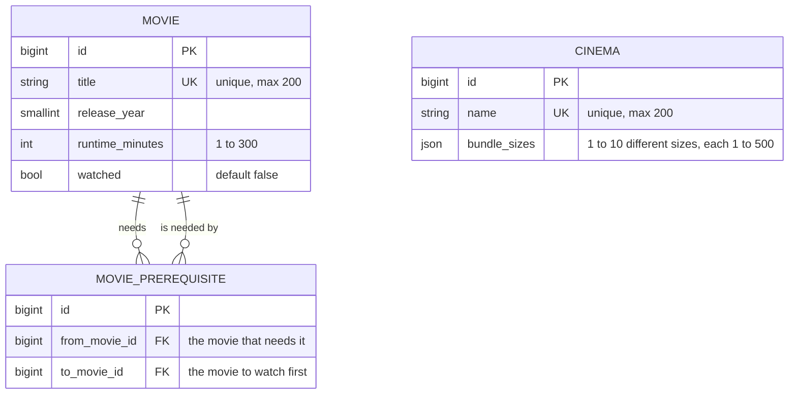

# Doomsday Ready

Plan your MCU rewatch before *Avengers: Doomsday* and book an opening-night watch party.

- **Backend:** Django REST Framework (PostgreSQL in Docker, SQLite locally)
- **Frontend:** React + Vite + Tailwind CSS + TypeScript (framer-motion intro hero)
- **Tests:** 46 backend tests (`python manage.py test`)

## Run it

### One command (Docker)

```bash
docker compose up --build
```

- App: http://localhost:3000
- API: http://localhost:8000/api (also reachable at http://localhost:3000/api)

The sample movies and cinemas from the challenge load on first start.
Set `SEED_DEMO: "0"` in `docker-compose.yml` to start empty.

### Without Docker

Backend (Python 3.10+):

```bash
cd backend
python -m venv .venv && source .venv/bin/activate
pip install -r requirements.txt
python manage.py migrate
python manage.py seed_demo      # optional sample data
python manage.py runserver      # http://localhost:8000
```

Frontend (Node 18+), in another terminal:

```bash
cd frontend
npm install
npm run dev                     # http://localhost:5173, /api is proxied to :8000
```

### Tests

```bash
cd backend
python manage.py test
```

## Intro hero and your own movie photos

The app opens with a 3D scroll-through intro (`frontend/src/components/ui/perspective-tunnel-hero.tsx`).
Click **Enter app** to skip it.

The cards use title-only placeholder images in `frontend/public/marvel/`. To show real photos:

Put your PNG files in `frontend/public/marvel/` with these names: `iron-man.png`,
`the-first-avenger.png`, `the-avengers.png`, `civil-war.png`, `ragnarok.png`,
`infinity-war.png`, `endgame.png`, `doomsday.png`. Any file that is missing shows a
title-only placeholder instead. Other names or formats: edit `frontend/src/data/heroImages.ts`.

Only use images you have the right to use. Movie posters and stills belong to their studios.

## Footer

The footer (`frontend/src/components/ui/doodle-crew-footer.tsx`) stamps **DOOMSDAY** in ink with a
hand-drawn crew and weapon doodles (hammer, round shield, bow, glowing ring) falling around it.
Click a character to make it talk, click a doodle to pop it. Text, crew and doodles are set in
`frontend/src/data/footerConfig.ts`. The footer buttons switch to the Rewatch Plan and Booking tabs.

## API

All paths are under `/api`. Errors always look like:

```json
{ "error": { "code": "CIRCULAR_DEPENDENCY", "message": "...", "details": {} } }
```

| Method and path | Purpose |
| --- | --- |
| `POST /movies` | Create a movie |
| `GET /movies` | List movies |
| `PATCH /movies/:id` | Update title, year, runtime, `description`, `image_url`, `watched`, `prerequisites`. Send `multipart/form-data` with an `image` file to upload a picture, or `{"remove_image": true}` to delete it |
| `GET /movies/:id/rewatch-order` | Rewatch order (Feature 1) |
| `POST /cinemas` | Create a cinema |
| `GET /cinemas` | List cinemas |
| `GET /cinemas/:id/booking?groupSize=6` | Booking quote (Feature 2) |
| `DELETE /movies/:id`, `DELETE /cinemas/:id` | Extra: remove one |

Status codes: `201` created, `200` ok, `400 VALIDATION_ERROR`, `404 NOT_FOUND`,
`409 CIRCULAR_DEPENDENCY`.

### Examples

```bash
# create a movie with prerequisites (ids of movies to watch first)
curl -X POST localhost:8000/api/movies -H 'Content-Type: application/json' \
  -d '{"title":"The Avengers","release_year":2012,"runtime_minutes":143,"prerequisites":[1,2]}'

# make Iron Man depend on Endgame -> 409
curl -X PATCH localhost:8000/api/movies/1 -H 'Content-Type: application/json' \
  -d '{"prerequisites":[7]}'
```

Rewatch order response:

```json
{
  "target": { "id": 4, "title": "Captain America: Civil War" },
  "order": [
    { "id": 1, "title": "Iron Man", "release_year": 2008, "runtime_minutes": 126, "watched": true },
    { "id": 2, "title": "Captain America: The First Avenger", "release_year": 2011, "runtime_minutes": 124, "watched": false },
    { "id": 3, "title": "The Avengers", "release_year": 2012, "runtime_minutes": 143, "watched": false }
  ],
  "total_count": 3,
  "watched_count": 1,
  "unwatched_runtime_minutes": 267
}
```

Booking quote response (`groupSize=44`, bundles 6, 9, 20):

```json
{
  "cinema": { "id": 3, "name": "Mega Screen", "bundle_sizes": [6, 9, 20] },
  "group_size": 44,
  "possible": true,
  "total_bundles": 4,
  "bundles": [ { "size": 20, "count": 1 }, { "size": 9, "count": 2 }, { "size": 6, "count": 1 } ]
}
```

If no exact combination exists the answer is still `200` with `"possible": false`,
`"bundles": []` and a message. It is a valid answer, not an error.

## How the logic works

Both features are written by hand in plain Python. No graph or solver libraries.

### Feature 1: movies (`backend/movies/services.py`)

Movies are a graph: each movie points to the movies you must watch before it.

- **Cycle check (`would_create_cycle`)**: before saving new prerequisites for movie `M`,
  walk down the prerequisites of each new prerequisite. If `M` shows up (or `M` lists
  itself), the change would make a loop, so the API returns `409 CIRCULAR_DEPENDENCY`
  and saves nothing. This catches direct and indirect loops. A new movie cannot be in a
  loop yet because nothing depends on it.
- **Rewatch order (`rewatch_order`)**: depth-first search from the target, adding a movie
  only *after* all of its own prerequisites. This gives an order where every movie comes
  after its prerequisites, each movie appears once, and the target is left out. It is
  iterative (no recursion), so a very long chain cannot crash it.
- **Summary**: `watched_count`, `total_count` and `unwatched_runtime_minutes` are
  calculated from that list.

### Feature 2: booking (`backend/cinemas/services.py`)

Dynamic programming (the coin-change problem). `best[n]` is the fewest bundles that make
exactly `n` seats, built from `best[n - size]` for every bundle size. Then walk back to
count each size. Time is `group_size × number_of_sizes`, at most 100,000 steps.

A greedy "take the biggest bundle first" fails on cases like sizes 1, 3, 4 with 6 seats
(greedy gives 4+1+1, the best is 3+3). The DP gets it right.

## Data model



`MOVIE_PREREQUISITE` is the automatic join table of the self-referencing
`Movie.prerequisites` field. Cinemas and movies are not linked.

## Choices I made (things the brief left open)

- **Release year** must be between 1888 and 2100. The brief only limits runtime (1 to 300).
- **Titles and cinema names** are unique ignoring upper/lower case.
- **Prerequisites** are sent as a list of movie ids. `PATCH` with a list replaces the whole
  set. Repeated ids are ignored. Unknown ids give `400`.
- **Movie image (optional)**: two ways, both optional.
  - **Upload from your computer**: pick a file in the Add form or the card editor. PNG, JPG, WEBP or GIF, max 5 MB, checked as a real image (so SVG and fake files give `400`). Files are saved in `backend/media/` (a Docker volume `media` in compose) and shown as `/media/movies/<name>`. Replacing or removing the image, or deleting the movie, deletes the old file.
  - **Image link**: `image_url` is an http(s) link or a site path such as `/marvel/iron-man.png`. Other values (for example `javascript:`) give `400`.
  - Cards show the uploaded image first, then the link, then the built-in poster that matches the title, then a plain header.
  - Uploaded files are served by Django itself. That is fine for this size; use a real file server or object storage for heavy traffic.
- **Description**: movies have an optional short description (max 300 characters), shown when a card is opened.
- **Self-dependency** (direct or indirect) gives `409 CIRCULAR_DEPENDENCY` on create-style
  and update requests alike. A new movie can only point to existing movies, so it is safe.
- **Rewatch order** is stable: ties are broken by movie id, so the same data always gives
  the same order.
- **Booking ties**: if two combinations use the same number of bundles, the one with
  bigger bundles is chosen.
- **Bundle sizes** must all be different (the brief says "different bundle sizes") and are
  stored sorted.
- **"Not possible"** is `200` with `possible: false`, not an error status.
- **Avengers: Doomsday** runtime in the seed data is a placeholder (150 min).
- **No login**, no pagination (the data set is small), no CORS (the frontend uses a proxy).
- **Frontend extras**: the Booking view has a small "Add a cinema" form so cinemas can be
  created from the UI, and the Rewatch Plan ticks can be toggled directly.

## AI use

I used an AI assistant (Claude by Anthropic) to help build this project: the Django and
React code, the tests, and this README. The graph and booking algorithms are
hand-written plain Python and use no libraries that solve them; the tests cover the
examples from the brief and extra edge cases.

<!-- gh: edit this section so it says exactly how YOU used AI and what you changed or checked yourself. -->
